<p align="center"></p>

<h1 align="center">WiZard</h1>

<p align="center">A Windows desktop app that syncs WiZ smart bulbs to your screen or your music, and controls them without the phone app.</p>

<p align="center">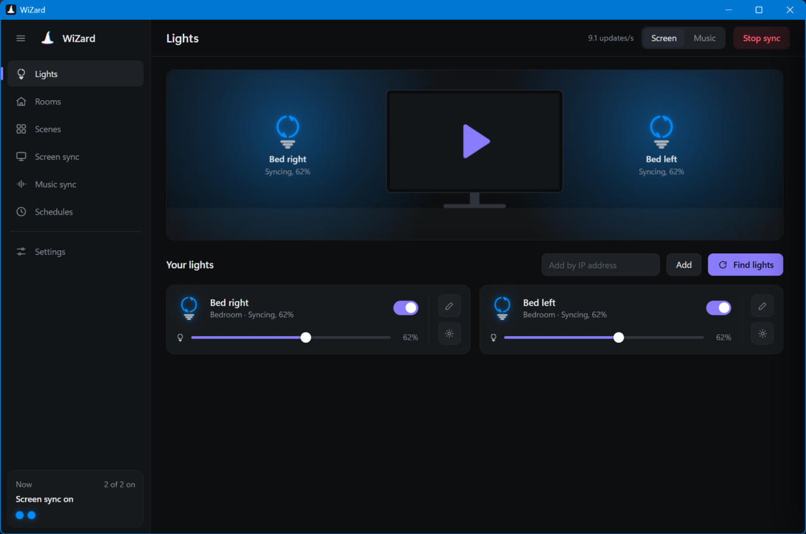</p>

> WiZard is an unofficial, independent project. It is not affiliated with, endorsed by or sponsored by Signify, WiZ Connected or Philips. "WiZ" and "Philips" are trademarks of their owners and are used here only to say which bulbs the app works with. See [Legal](#legal).

## What it does

WiZard talks to WiZ bulbs over your home Wi-Fi. Nothing goes through a cloud service, and changes reach the bulbs right away.

- **Screen sync.** Each light takes the color of the part of the screen you choose (full screen, a half, the center or a corner), up to 20 times a second. Pick Vivid, Average or Dominant color, and save your favorite settings as presets.
- **Music sync.** Lights react to whatever plays on the PC (Spotify, YouTube, games) through Windows loopback audio. There are five styles:
  - **Calm rhythm** holds one color, swells with each beat between a low and a high brightness, and moves to a new color every few beats.
  - **Dynamic rhythm** holds one color, flashes it on with each beat and off in between, and moves to a new color every few beats.
  - **Beat pulse**, **Spectrum** and **Mellow** jump on every beat, show bass, mids and highs as colors, or drift slowly with the volume.

  The rhythm styles follow the kick drum, track the tempo, and change color early when the music suddenly gets louder, such as at a drop or a chorus. Each style keeps its own settings, and **Set as default** saves your tuning as that style's defaults.
- **Manual control.** A color wheel, quick colors, whites from 2200K to 6500K, brightness, power and a sleep timer.
- **Scenes.** All 34 built-in WiZ scenes, from Fireplace and Ocean to Cozy, Diwali and Alarm, with speed and brightness.
- **Rooms.** Group lights into rooms and control a room as one light.
- **Schedules.** Turn lights on or off, set a white, color or scene, run wake-up and bedtime fades, or start and stop sync on chosen days.
- **Room preview.** The top of the Lights page shows each light's color on the wall. The monitor shows what is driving the lights: a play symbol for screen sync, an equalizer for music sync, the scene or color otherwise, and a second display on the matching side if Windows has one.
- **Light tools.** Rename a light in place, and use **Identify** to flash it warm white once so you can tell which bulb is which.
- **Tray menu.** Click the tray icon for a menu in the app's style, or double-click it to open WiZard. Start with Windows, and only one copy runs at a time.
- **Light on your PC.** The window runs at below-normal priority, switches to Windows efficiency mode and pauses its page while hidden in the tray, and screen sync works out a frame in about 2 ms. See [Performance](#performance).
- When you exit, every light is set to the Cozy scene at full brightness.

## Screenshots

| | |
| --- | --- |
| **Lights**, the home page<br>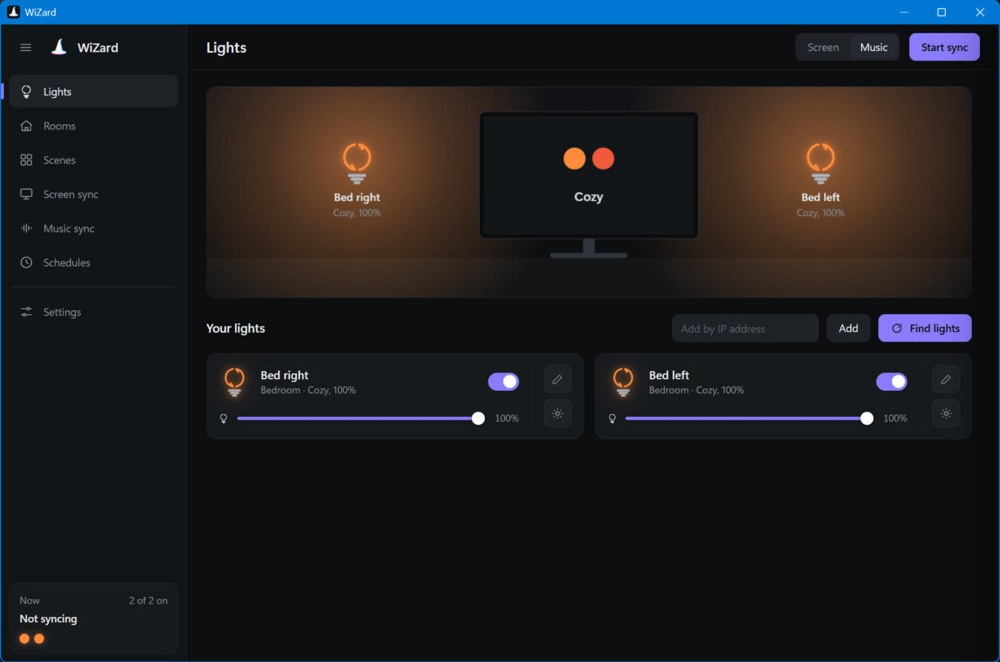 | **Screen sync** with presets and screen areas<br>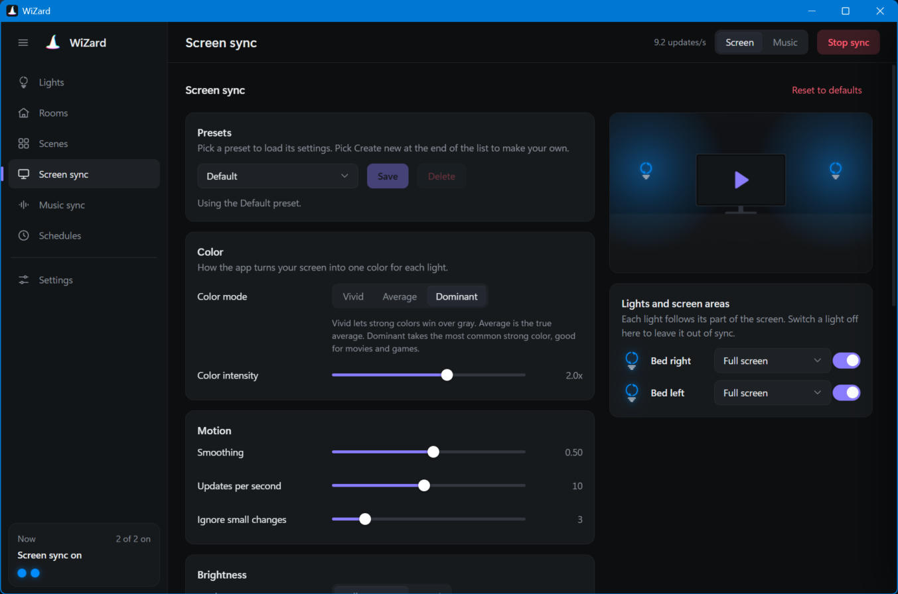 |
| **Music sync** styles and rhythm settings<br>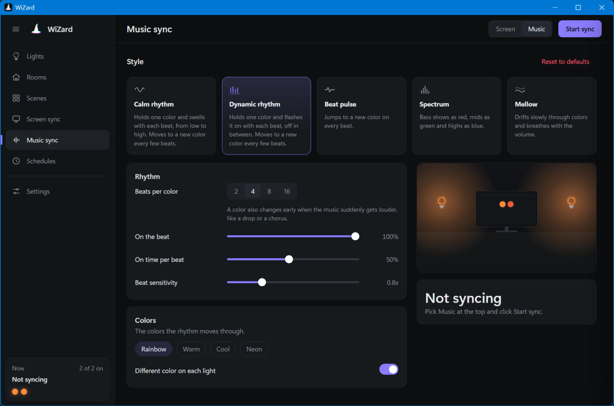 | **Scenes** for any light or room<br>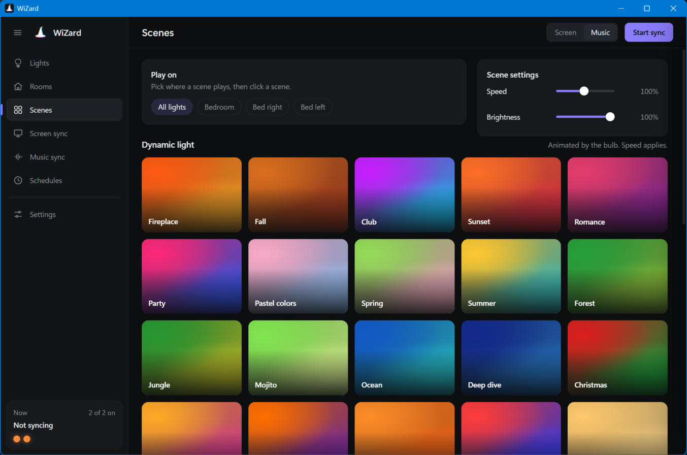 |
| **Rooms**<br>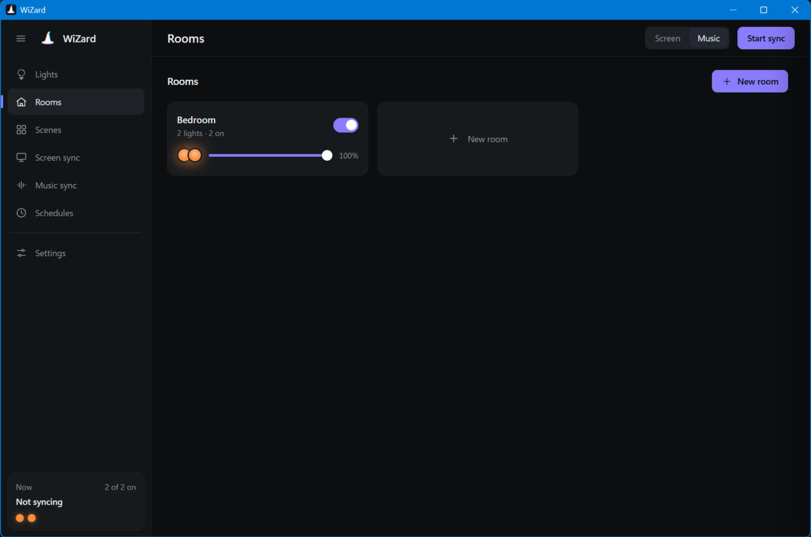 | **A room**, Control tab<br>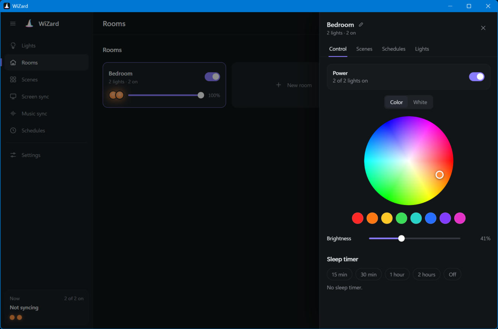 |
| **A room**, Scenes tab<br>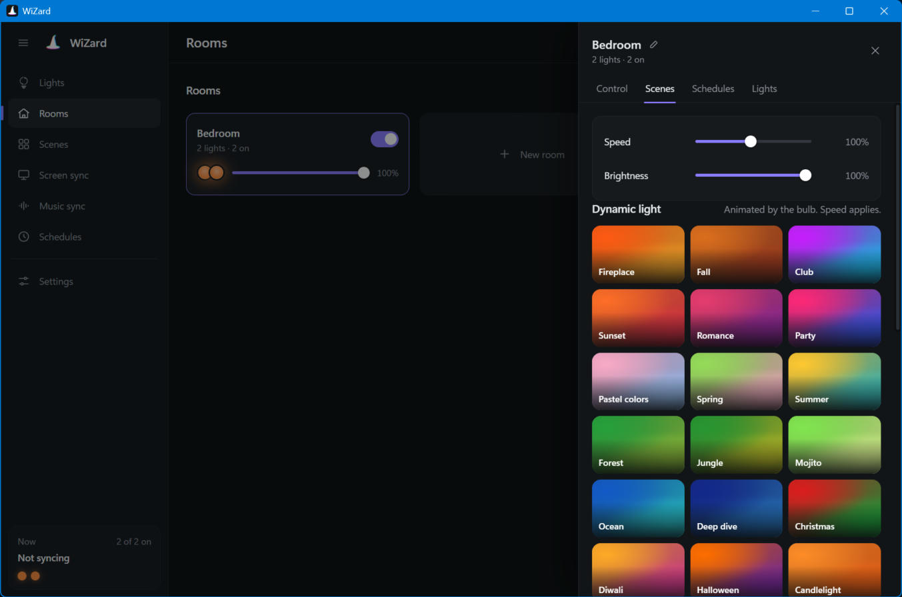 | **A light**, Settings tab with Rename and Identify<br>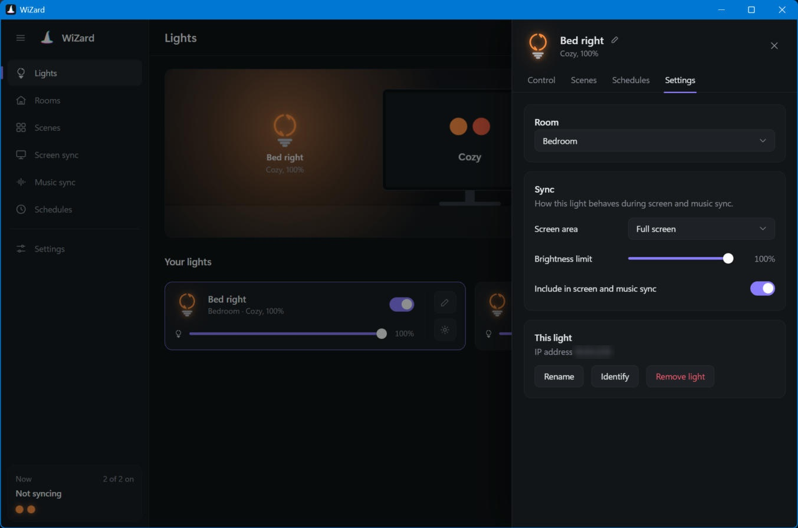 |
| **Schedules**, adding a wake-up fade<br>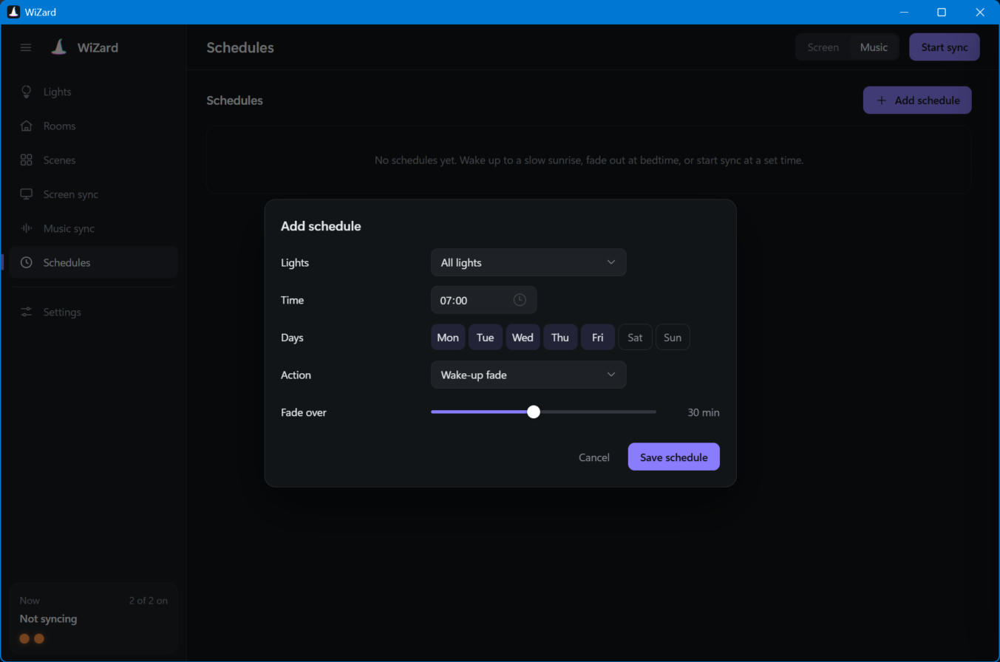 | **Settings**<br>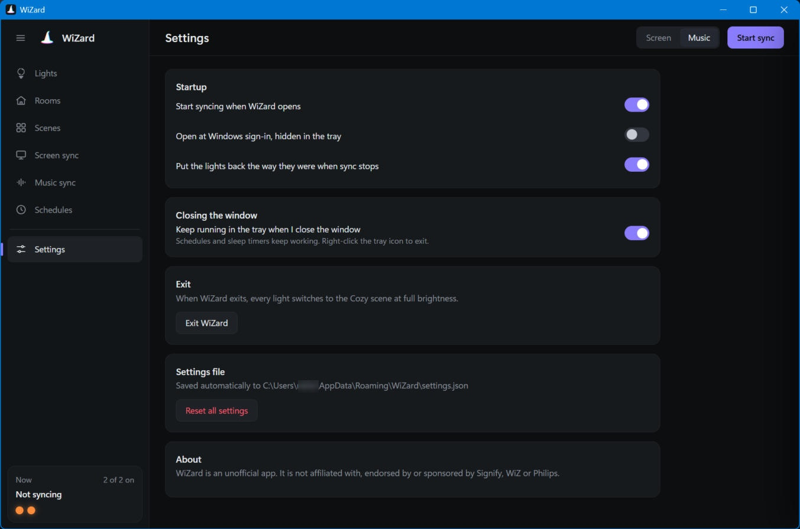 |

The tray menu opens with one click on the tray icon:

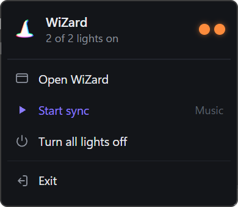

## Requirements

- Windows 10 or 11. Screen capture, the tray, loopback audio and the window are written for Windows. Other systems are untested.
- Python 3.10 or newer.
- Microsoft Edge WebView2 Runtime. It comes with Windows 11 and is already installed on most Windows 10 PCs. If the window stays blank, install it from Microsoft.
- WiZ bulbs on the same Wi-Fi network as the PC.
- Local communication allowed in the WiZ phone app. On recent versions of the app this setting is under Settings, then Security. The name and place can change between app versions.

## Install and run

Open PowerShell and run these one at a time:

```powershell
git clone https://github.com/MihirSheth25/wizard-light-sync.git
```

```powershell
cd wizard-light-sync
```

```powershell
python -m pip install -r requirements.txt
```

```powershell
python wizard.py
```

On the Lights page, click **Find lights**. If a light does not show up, type its IP address in the box next to **Add**. You can find the address in the WiZ app under the bulb's settings, or in your router's device list.

## Build a standalone .exe

PyInstaller turns the app into one file you can pin to the Start menu or taskbar.

```powershell
python -m pip install pyinstaller
```

```powershell
pyinstaller --noconfirm --onefile --windowed --name "WiZard" --icon wiz.ico --add-data "wiz.ico;." --add-data "ui;ui" --add-data "assets;assets" --collect-all soundcard --hidden-import pystray._win32 wizard.py
```

The app ends up in `dist\WiZard.exe`. Exit WiZard from the tray before you rebuild, or Windows will refuse to replace the file. If you share the .exe with other people, read [THIRD_PARTY_NOTICES.md](THIRD_PARTY_NOTICES.md) first, because the .exe contains other projects' code.

## Using it

1. Find your lights on the Lights page. Click the pencil to rename one, or the sun button to identify it.
2. Open a light and pick its screen area under Settings. A light on the left of your desk usually looks best on Left half.
3. Choose **Screen** or **Music** at the top right, then click **Start sync**.
4. Click a light, or a room on the Rooms page, to open its Control, Scenes, Schedules and Settings tabs.
5. Closing the window keeps WiZard in the tray, so schedules still run. Click the tray icon and choose **Exit** to quit.

### Screen sync presets

The presets list on the Screen sync page loads a full set of screen sync settings. Change anything on the page and a note says the settings differ from the preset. Click **Save** to store the change in that preset. Pick **Create new** at the end of the list, type a name, adjust the settings and click **Save** to add your own. **Reset to defaults** puts the page back to the app's original values and leaves every preset alone.

### Music sync styles

Each music style remembers its own settings, so tuning Dynamic rhythm leaves Calm rhythm as it was. When you change a slider, **Set as default** appears next to **Reset to defaults**. It saves the current values as that style's defaults, and Reset to defaults then returns to them.

### Settings file

Settings are saved to `%APPDATA%\WiZard\settings.json`. That file holds your light names, IP addresses, rooms, schedules and presets. Keep it out of any public repository. The `.gitignore` here already excludes it.

## How it works

WiZ bulbs accept JSON messages over UDP on port 38899 on the local network.

| Message | Use in WiZard |
| --- | --- |
| `{"method":"getPilot"}` sent to the broadcast address | Find bulbs on the network |
| `{"method":"getPilot"}` sent to one bulb | Read its current state |
| `{"method":"setPilot","params":{"r":255,"g":120,"b":40,"dimming":80}}` | Set a color and brightness |
| `{"method":"setPilot","params":{"temp":3000,"dimming":70}}` | Set a white |
| `{"method":"setPilot","params":{"sceneId":6,"speed":100,"dimming":100}}` | Play a scene |

Screen sync grabs the chosen monitor with `mss`, samples every Nth pixel, and turns each light's screen area into one color. Then it applies smoothing and a brightness curve and sends the result only when the color has changed enough.

Music sync reads the speakers' loopback stream with `soundcard` and splits each block into frequency bands. The rhythm styles look for sudden jumps in kick-drum energy, estimate the tempo from the gaps between kicks, and run a beat grid at 40 ticks a second. Each light gets at most about 16 messages a second, which the bulbs handle smoothly.

This protocol is not an official, documented API. A firmware update could change it. WiZard only uses it to control bulbs that you own on your own network.

### Architecture

| Layer | File | What it does |
| --- | --- | --- |
| Engine | `wiz_core.py` | Bulb protocol, settings file, screen and music sync engines, beat and tempo tracking, fades |
| Controller | `wiz_controller.py` | App state, rooms, schedules, sleep timers, presets and sync, with no interface code |
| Host | `wizard.py` | Window (pywebview on WebView2), JavaScript bridge, tray icon and menu, single copy, Windows power and memory tuning |
| Interface | `ui/` | The page itself: `index.html`, `style.css`, `app.js`, and `tray.html` for the tray menu |

Updates from Python to the page are coalesced: if several states are waiting, only the newest one is sent.

## Performance

A November 2026 pass made the busiest code paths several times faster without changing any output.

| Work | Before | After |
| --- | --- | --- |
| Screen sync frame, 2 lights on Full screen | 14.3 ms | 2.0 ms |
| Screen sync frame, 3 lights on Full screen | 20.9 ms | 2.1 ms |
| Music analysis, one block | 0.18 ms | 0.08 ms |
| Settings read by the sync engines | 0.107 ms | under 0.001 ms |

[docs/PERFORMANCE.md](docs/PERFORMANCE.md) explains each change, its trade-offs, the options that were left out, and how the new code was checked to produce exactly the same results. Run `python tools\benchmark.py` to measure your own PC.

## Development

`tools/dev_server.py` serves the interface in a normal browser at http://127.0.0.1:8765, wired to the real app logic. It is useful for working on the page without building the app.

```powershell
python tools\dev_server.py
```

## Project layout

| Path | What it is |
| --- | --- |
| `wizard.py` | Starts the app: window, tray, bridge to the page |
| `wiz_controller.py` | App state and actions, independent of the interface |
| `wiz_core.py` | Bulb protocol, settings and sync engines |
| `ui/` | The interface (HTML, CSS, JavaScript) and the logo |
| `assets/` | Logo and tray icons as PNG files |
| `wiz.ico` | App and taskbar icon |
| `tools/dev_server.py` | Browser preview of the interface |
| `tools/benchmark.py` | Measures the hot paths on your PC |
| `docs/` | Performance notes and the screenshots in this README |
| `requirements.txt` | Python packages the app needs |
| `THIRD_PARTY_NOTICES.md` | Licenses of the packages WiZard uses |

## Troubleshooting

| Problem | Try this |
| --- | --- |
| Find lights finds nothing | Make sure the PC and bulbs are on the same network and local communication is allowed in the WiZ app. Some guest networks and mesh setups block broadcast traffic, so try adding the light by IP address. |
| The window is blank | Install or repair the Microsoft Edge WebView2 Runtime. |
| Lights stay one color during screen sync | Check which monitor is chosen on the Screen sync page. With two displays, pick the one you watch. |
| Colors look washed out | Raise Color intensity, or switch Color mode to Dominant. |
| Music sync does nothing | Make sure sound plays through the default output device. If the page says music sync needs one more package, run `python -m pip install soundcard` and restart the app. |
| The taskbar shows an old icon | Unpin WiZard, start the new .exe, and pin it again. Windows caches pinned icons. |
| A second copy will not open | WiZard allows one copy. Starting it again brings the running copy to the front. |

## Legal

- WiZard is independent software. It is not made, endorsed or supported by Signify, WiZ Connected, Philips or any other bulb maker. Product names are used only to describe compatibility.
- WiZard contains no code, images, fonts or files from the WiZ app or any other company's product. The logo, the icons, the room preview and all interface artwork were drawn for this project. Scene names and numbers match what the bulbs report, so the app can name them.
- The interface uses the Segoe UI fonts that ship with Windows and does not include any font files.
- Third-party Python packages are installed from PyPI, not copied into this repository. Their licenses are listed in [THIRD_PARTY_NOTICES.md](THIRD_PARTY_NOTICES.md).
- The software is provided as is, without warranty. See [LICENSE](LICENSE).

## License

WiZard is released under the [MIT License](LICENSE). Copyright (c) 2026 Mihir Sheth.
