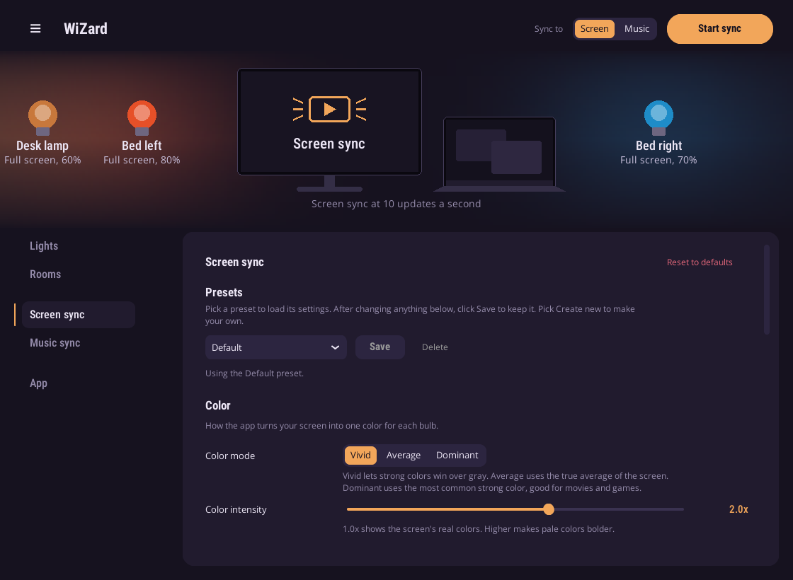
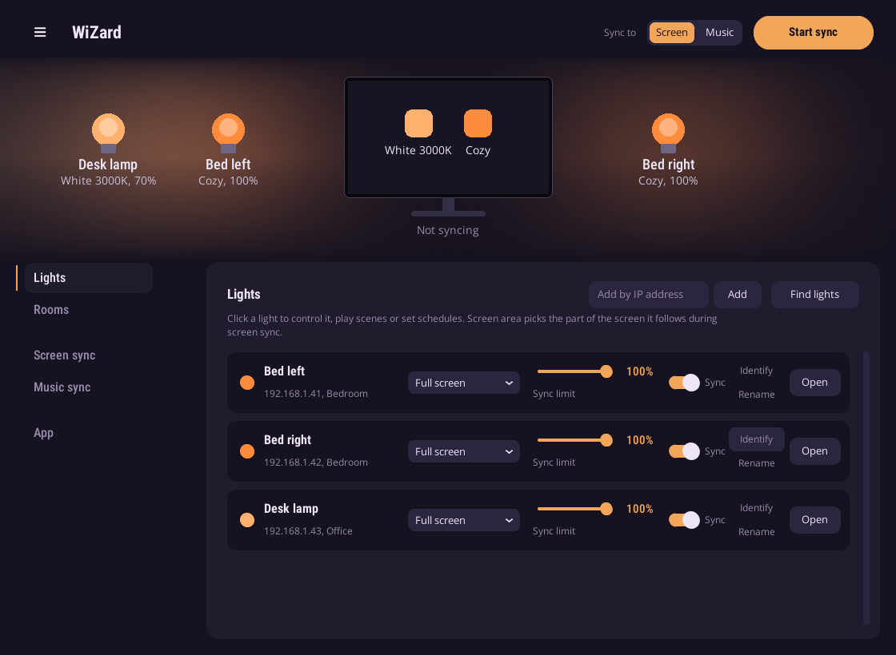
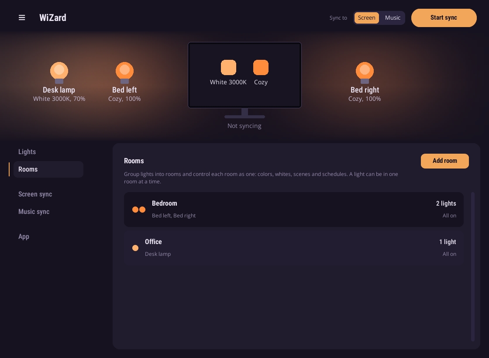
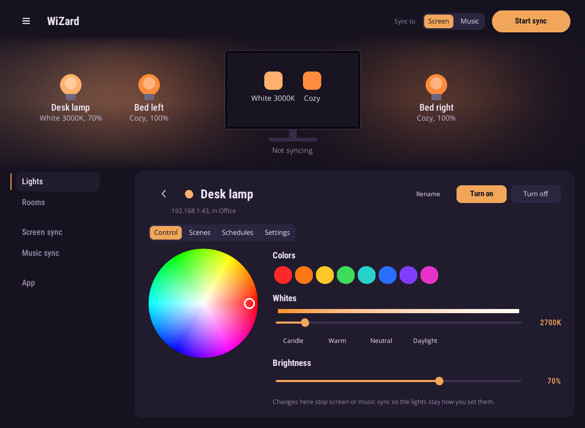
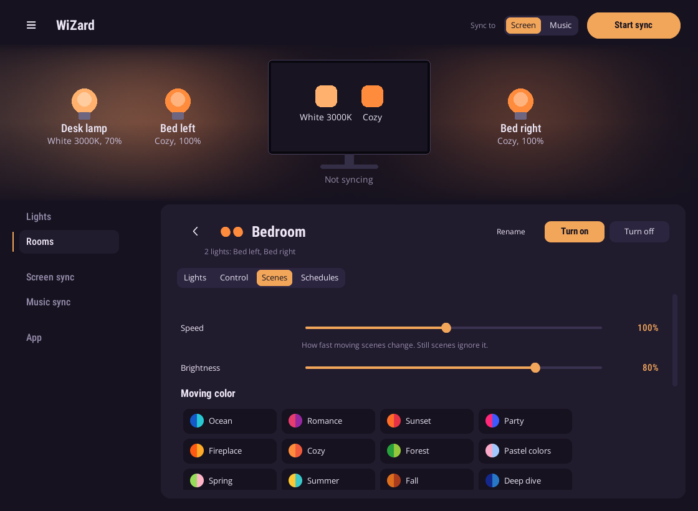
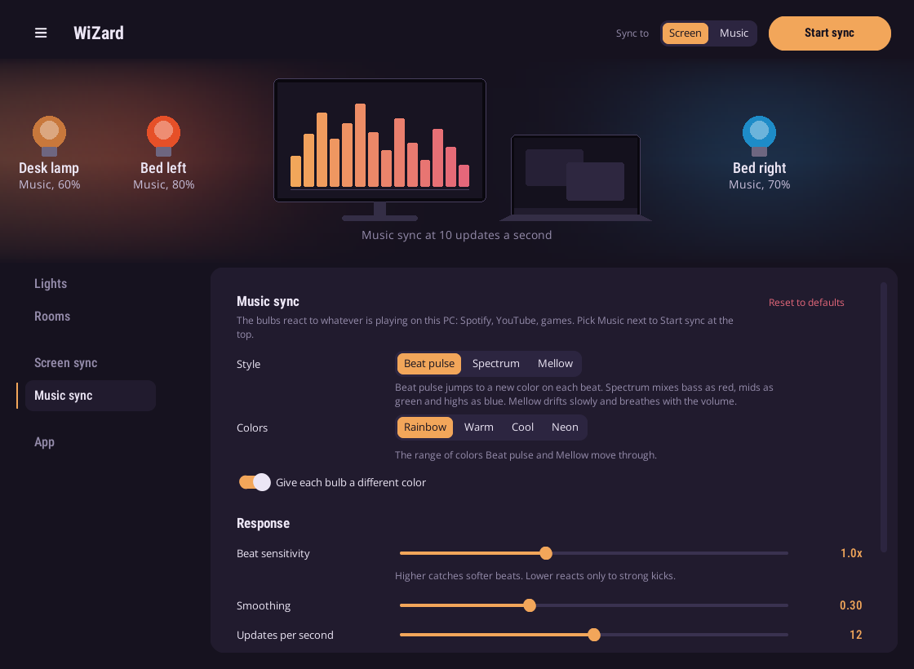
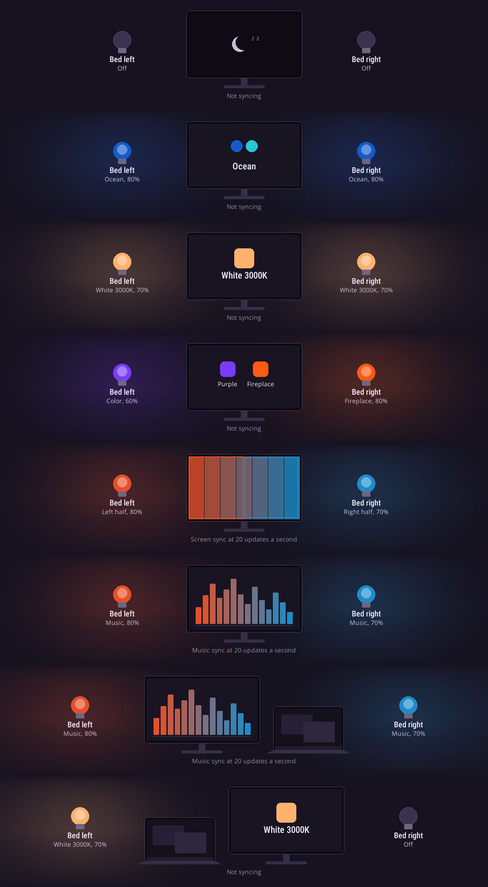

<p align="center"></p>

<h1 align="center">WiZard</h1>

<p align="center">A Windows desktop app that syncs WiZ smart bulbs to your screen or your music, and controls them without the phone app.</p>

<p align="center"></p>

> WiZard is an unofficial, independent project. It is not affiliated with, endorsed by or sponsored by Signify, WiZ Connected or Philips. "WiZ" and "Philips" are trademarks of their owners and are used here only to say which bulbs the app works with. See [Legal](#legal).

## What it does

WiZard talks to WiZ bulbs over your home Wi-Fi. Nothing goes through a cloud service, and changes reach the bulbs right away.

- Screen sync: each bulb takes the color of the part of the screen you choose (full screen, left half, top right and so on), up to 20 times a second.
- Music sync: bulbs react to whatever plays on the PC (Spotify, YouTube, games) through Windows loopback audio. There are three styles: Beat pulse, Spectrum and Mellow.
- Manual control: a color wheel, quick colors, whites from 2200K to 6500K, brightness, and on or off.
- Scenes: the 32 built-in bulb scenes, with speed and brightness.
- Rooms: group lights into rooms and control a room as one light.
- Schedules: turn on or off, set a white, color or scene, wake-up and bedtime fades, or start and stop sync on chosen days.
- Sleep timer for any light or room.
- Screen sync presets: Default, Movie, Gaming, Chill and Party, all editable, plus your own presets.
- A room preview at the top of the window that shows each bulb's color on the wall and what is driving the lights. If Windows shows a second display, a laptop appears on the matching side.
- Tray icon, start with Windows, and one running copy at a time.
- When you exit, every light is set to the Cozy scene at full brightness.

## Screenshots

| Page | Screenshot |
| --- | --- |
| Lights (home) |  |
| Rooms |  |
| One light, Control tab |  |
| One room, Scenes tab |  |
| Screen sync settings and presets |  |
| Music sync settings |  |

The monitor in the room preview changes with what is driving the lights: off, a scene, a white or color, mixed looks, screen sync, music sync, and a second display on either side.



The screenshots use example bulb names and made-up addresses.

## Requirements

- Windows 10 or 11. Screen capture, the tray icon and loopback audio are written for Windows. Other systems are untested.
- Python 3.10 or newer.
- WiZ bulbs on the same Wi-Fi network as the PC.
- Local communication allowed in the WiZ phone app. On recent versions of the app this setting is under Settings, then Security. The name and place can change between app versions.

## Install and run

Open PowerShell and run these one at a time:

```powershell
git clone https://github.com/MihirSheth25/wizard-light-sync.git
```

```powershell
cd wizard-light-sync
```

```powershell
python -m pip install -r requirements.txt
```

```powershell
python wiz_sync_app.py
```

On the Lights page, click Find lights. If a bulb does not show up, type its IP address in the box next to Add. You can find the address in the WiZ app under the bulb's settings, or in your router's device list.

## Build a standalone .exe

PyInstaller turns the script into one file you can pin to the Start menu or taskbar.

```powershell
python -m pip install pyinstaller
```

```powershell
pyinstaller --onefile --windowed --name "WiZard" --icon wiz.ico --add-data "wiz.ico;." --collect-all customtkinter --collect-all soundcard --hidden-import pystray._win32 wiz_sync_app.py
```

The app ends up in `dist\WiZard.exe`. Exit WiZard from the tray before you rebuild, or Windows will refuse to replace the file. If you share the .exe with other people, read [THIRD_PARTY_NOTICES.md](THIRD_PARTY_NOTICES.md) first, because the .exe contains other projects' code.

## Using it

1. Find lights on the Lights page. Click a name to rename it in place.
2. Pick a screen area for each bulb. A bulb on the left of your desk usually looks best on Left half.
3. Choose Screen or Music next to Start sync, then click Start sync.
4. Click a light, or a room on the Rooms page, to open its Control, Scenes, Schedules and Settings tabs.
5. Closing the window keeps WiZard in the tray, so schedules still run. Right-click the tray icon and choose Exit to quit.

### Screen sync presets

The presets dropdown on the Screen sync page loads a full set of screen sync settings. Change anything on the page and a note says the settings differ from the preset. Click Save to store the change in that preset. Pick Create new at the end of the dropdown, type a name, adjust the settings, and click Save to add your own. Default holds the settings you had when presets were first added. Reset to defaults puts the page back to the app's original values and leaves every preset alone.

### Settings

Settings are saved to `%APPDATA%\WiZard\settings.json`. That file holds your bulb names, IP addresses, rooms, schedules and presets. Keep it out of any public repository. The `.gitignore` here already excludes it.

## How it works

WiZ bulbs accept JSON messages over UDP on port 38899 on the local network.

| Message | Use in WiZard |
| --- | --- |
| `{"method":"getPilot"}` sent to the broadcast address | Find bulbs on the network |
| `{"method":"getPilot"}` sent to one bulb | Read its current state |
| `{"method":"setPilot","params":{"r":255,"g":120,"b":40,"dimming":80}}` | Set a color and brightness |
| `{"method":"setPilot","params":{"temp":3000,"dimming":70}}` | Set a white |
| `{"method":"setPilot","params":{"sceneId":6,"speed":100,"dimming":100}}` | Play a scene |

Screen sync grabs the chosen monitor with `mss`, samples every Nth pixel, and turns each bulb's screen area into one color (Vivid, Average or Dominant). Then it applies smoothing and a brightness curve and sends the result only when the color has changed enough. Music sync reads the speakers' loopback stream with `soundcard`, splits it into bass, mid and high bands, and detects beats from jumps in bass energy.

This protocol is not an official, documented API. A firmware update could change it. WiZard only uses it to control bulbs that you own on your own network.

## Project layout

| Path | What it is |
| --- | --- |
| `wiz_sync_app.py` | The whole app: bulb protocol, sync engines and user interface |
| `wiz.ico` | App and tray icon |
| `requirements.txt` | Python packages the app needs |
| `docs/screenshots/` | Images used in this README |
| `THIRD_PARTY_NOTICES.md` | Licenses of the packages WiZard uses |

## Troubleshooting

| Problem | Try this |
| --- | --- |
| Find lights finds nothing | Make sure the PC and bulbs are on the same network and local communication is allowed in the WiZ app. Some guest networks and mesh setups block broadcast traffic, so try adding the bulb by IP address. |
| Lights stay one color during screen sync | Check which monitor is chosen under Screen sync, then Monitor. With two displays, pick the one you watch. |
| Colors look washed out | Raise Color intensity, or switch Color mode to Dominant. |
| Music sync does nothing | Run `python -m pip install soundcard`, then restart the app. Make sure sound plays through the default output device. |
| A second copy will not open | WiZard allows one copy. Starting it again brings the running copy to the front. |

## Legal

- WiZard is independent software. It is not made, endorsed or supported by Signify, WiZ Connected, Philips or any other bulb maker. Product names are used only to describe compatibility.
- WiZard contains no code, images, fonts or files from the WiZ app or any other company's product. The icon, the room preview and all interface artwork were drawn for this project. Scene names and numbers match what the bulbs report, so the app can name them.
- The app uses system fonts that ship with Windows (Bahnschrift and Segoe UI) and does not include any font files.
- Third-party Python packages are installed from PyPI, not copied into this repository. Their licenses are listed in [THIRD_PARTY_NOTICES.md](THIRD_PARTY_NOTICES.md).
- The software is provided as is, without warranty. See [LICENSE](LICENSE).

## License

WiZard is released under the [MIT License](LICENSE). Copyright (c) 2026 Mihir Sheth.
